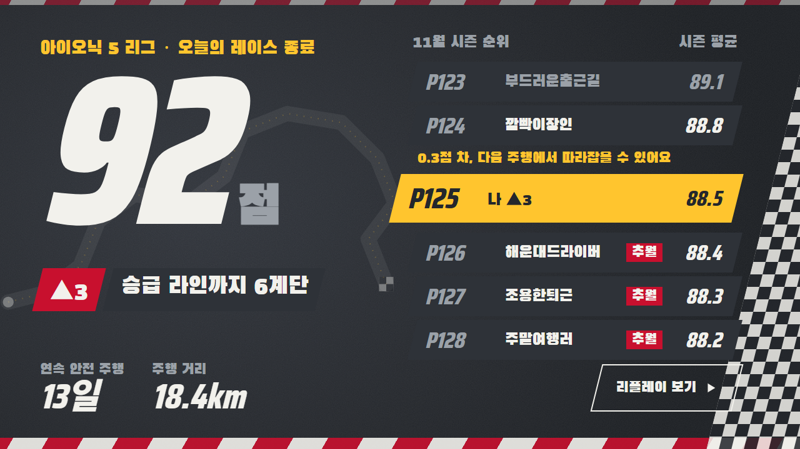
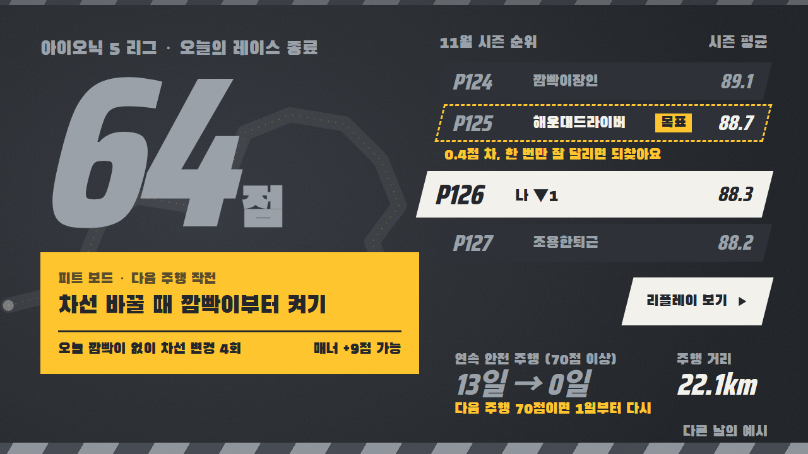
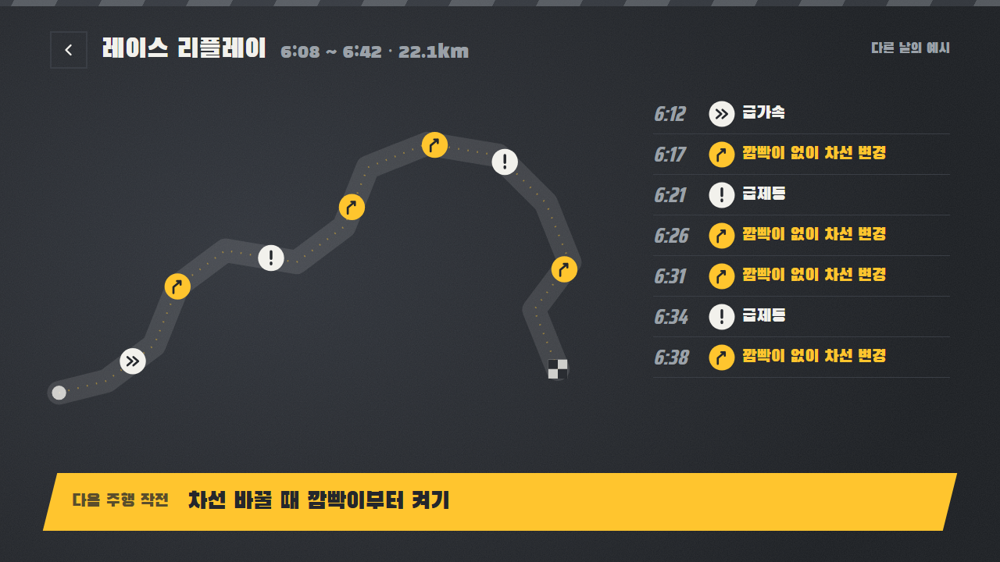
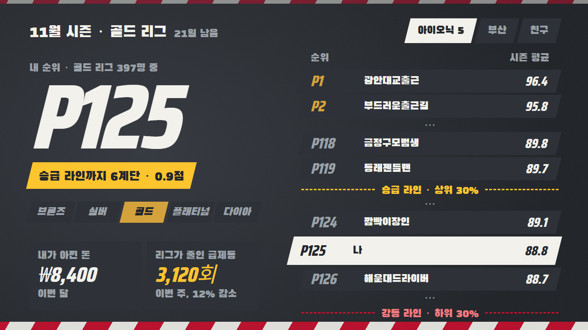
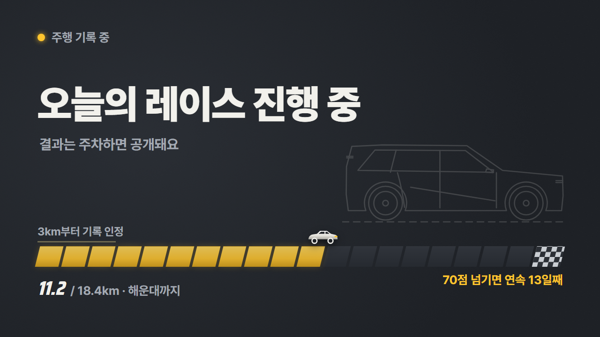
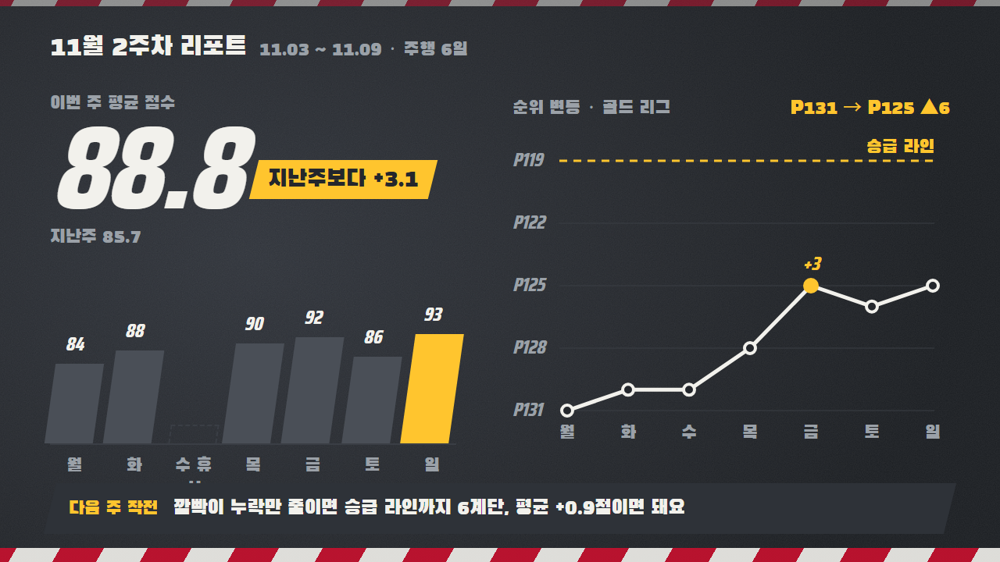

# 세이프티 리그 (Safety League)

실제 차량 신호(방향지시등·브레이크·조향각·안전벨트·경고등)로 트립마다 안전 운전 점수(100점)를 매기고,
같은 차종 운전자끼리 월간 시즌 리그로 겨루는 Pleos Connect(AAOS) 앱.

## 구현 현황

Pleos Connect 에뮬레이터에서 동작하는 안드로이드 앱입니다. 소스는 [`app/`](app/)에 있습니다.

- 실제 차량 신호 수집: Vehicle State SDK, AAOS CarPropertyManager
- 트립 점수, 결과 카드, 레이스 리플레이, 주간 리포트, 월간 시즌 정산
- 주행 중 화면 제한(CarUxRestrictions), 경로 기록 동의
- 점수 계산은 순수 함수로 분리했고 단위 테스트가 있습니다.

리그의 다른 운전자는 시연용 가상 데이터입니다. 순위 서버 연동은 출시 후 계획입니다. 에뮬레이터는 전비 신호를 지원하지 않습니다.

## 빌드와 실행

필요한 것: JDK 17, Android SDK 34, [Pleos Connect 에뮬레이터](https://document.pleos.ai/docs/connect/guide/getting-started/application-development/setup-connect-sdk-emulator).

```
./gradlew assembleDebug          # 앱 빌드
./gradlew testDebugUnitTest      # 단위 테스트
adb install -r app/build/outputs/apk/debug/app-debug.apk
adb forward tcp:8088 tcp:8088    # Virtual Console: http://127.0.0.1:8088/
```

Virtual Console에서 기어를 D로 놓고 ACCEL로 3km 이상 달린 뒤 P로 바꾸면 결과 카드가 뜹니다. 앱 왼쪽 위 모서리를 길게 누르면 시연 모드가 열립니다.

## 화면 시안

**주행 결과 — 잘 달린 날.** 주차(P단)하면 레이스 종료 화면이 뜹니다. 오늘 제친 운전자와 승급 라인까지 남은 거리가 보입니다.



**주행 결과 — 아쉬운 날.** 감점을 나열하지 않고, 다음 주행에서 고칠 것 하나만 "피트 보드"로 보여 줍니다.



**레이스 리플레이.** 결과 카드에서 "리플레이 보기"를 누르면, 오늘 달린 경로 위에 급제동·급가속·깜빡이 누락 지점을 시간순으로 보여 줍니다. 경로는 내 화면에만 보입니다.



**리그 순위.** 월간 시즌, 같은 티어 안에서 상위 30% 승급·하위 30% 강등. 안전운전으로 아낀 돈과 리그 전체가 줄인 급제동도 함께 보여 줍니다.



**주행 중.** 점수·순위는 숨기고(CarUxRestrictions), 기록이 쌓이는 트랙만 보여 줍니다. 3km 미만 트립은 점수에서 제외됩니다.



**주간 리포트.** 이번 주 점수 변화와, 요일별 순위 변화를 F1 포지션 차트처럼 보여 줍니다.



시안의 운전자와 숫자는 모두 시연용 가상 데이터입니다. 소스: [`mockups/`](mockups/) (HTML, `node mockups/export.js`로 PNG 생성, `node --test "mockups/test/*.test.js"`로 검사).

## 점수 구성 (100점)
| 항목 | 배점 | 기준 |
|---|---|---|
| 부드러움 | 30 | 10km당 급가속·급감속 |
| 매너 | 25 | 깜빡이 없는 차선 변경 추정 비율 |
| 에코 | 20 | 같은 차종 평균 대비 전비/연비 |
| 안전 기본기 | 15 | 출발 전 전 좌석 벨트, 경고 해결 시간 |
| 꾸준함 | 10 | 연속 안전 주행일, 주행거리 |

공정성: 10km당 환산, 3km 미만 트립 제외, EV/내연기관 리그 분리.
