<div align="center">


# Safety League

**빨리 달리는 사람이 아니라, 안전하게 운전하는 사람이 이기는 리그.**

실제 차량 신호로 트립마다 안전 운전 점수(100점)를 매기고<br>
같은 차종 운전자끼리 월간 시즌 리그로 겨루는 Pleos Connect 앱


[소개](#소개) · [화면](#화면) · [점수](#점수-산식) · [차량 신호](#차량-신호) · [시작하기](#시작하기) · [구조](#프로젝트-구조)

<br>

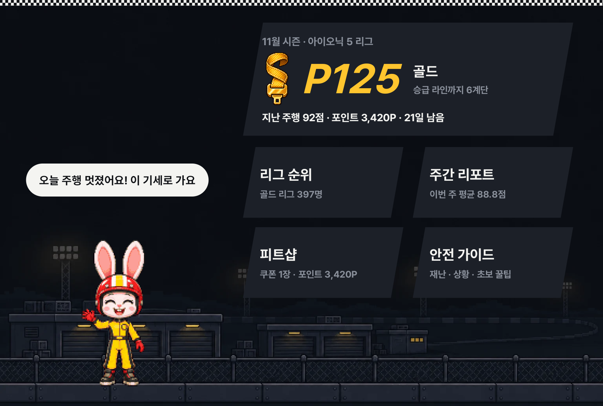

</div>

<br>

## 소개

운전 습관은 피드백이 없으면 바뀌지 않습니다. 내비 앱의 운전 점수는 휴대폰 GPS와 가속도로 **추정**할 뿐,
깜빡이·브레이크·조향각·안전벨트처럼 차 안에서만 나오는 신호는 보지 못합니다.

Safety League는 Pleos Connect가 열어 준 차량 데이터를 **경쟁과 보상**에 연결합니다.

- 🏁 **주행할 때마다 자동 참여.** 화면 조작 없이 백그라운드에서 신호를 모으고, 기어를 P로 바꾸면 결과 카드가 뜹니다.
- 🏆 **같은 차종끼리 월간 시즌.** 브론즈부터 다이아까지 다섯 티어, 상위 30% 승급, 하위 30% 강등입니다.
- 🐰 **혼내지 않는 피드백.** 아쉬운 날에는 감점 목록 대신 다음에 고칠 것 하나만 피트 보드로 보여 줍니다.
- 🛑 **주행 중에는 조용히.** `CarUxRestrictionsManager`를 따라 점수·순위 화면은 주차 중에만 엽니다.

> [!NOTE]
> 리그의 다른 운전자, 상품, 쿠폰은 **시연용 가상 데이터**이며 실제로 발급되지 않습니다.

<br>

## 화면

Pleos Connect 에뮬레이터에서 찍은 실제 앱 화면입니다.

<table>
<tr>
<td width="50%">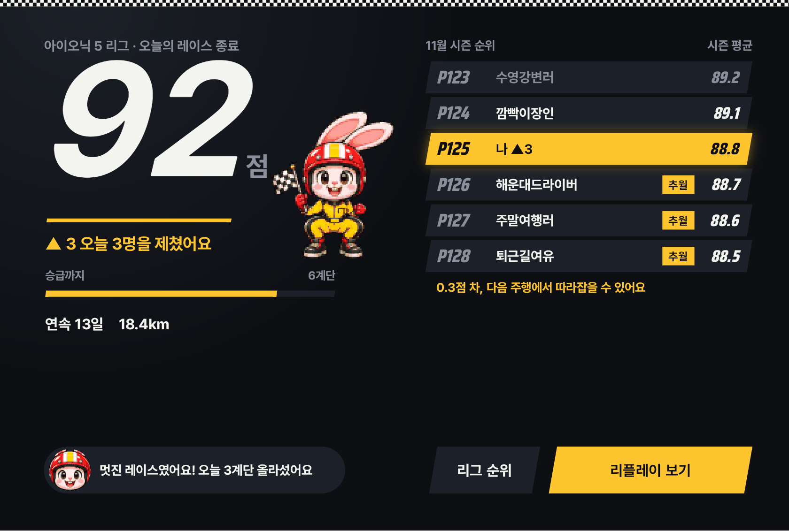</td>
<td width="50%">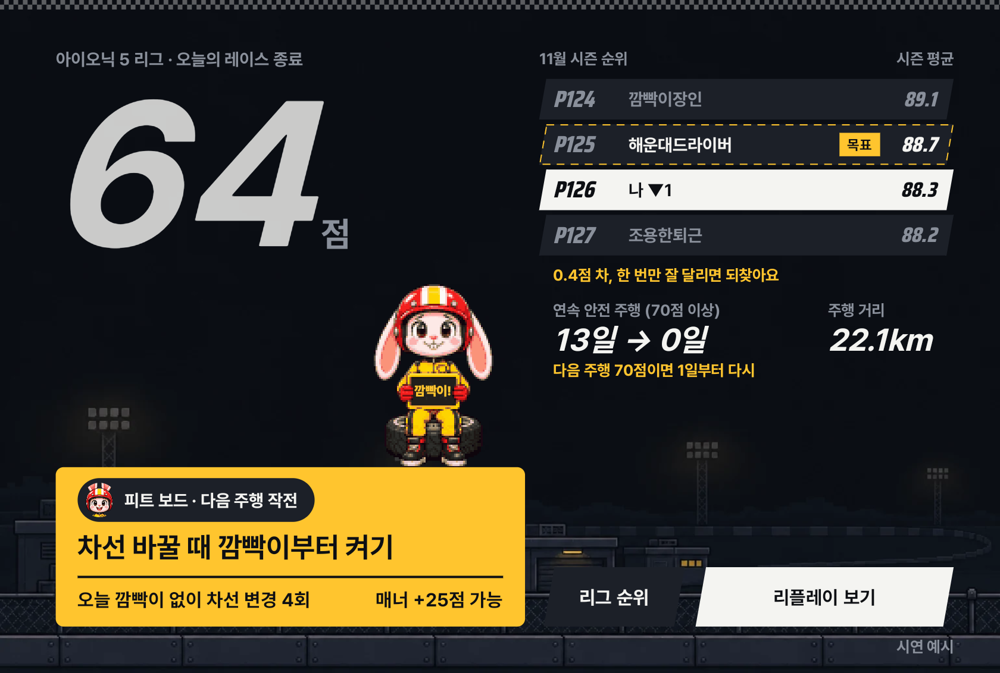</td>
</tr>
<tr>
<td><b>결과 카드: 잘 달린 날</b><br><sub>P단으로 바꾸면 제친 운전자와 승급 라인까지 남은 거리를 보여 줍니다.</sub></td>
<td><b>결과 카드: 아쉬운 날</b><br><sub>빨강과 감점 목록 없이, 고칠 것 하나만 피트 보드에 띄웁니다.</sub></td>
</tr>
<tr>
<td>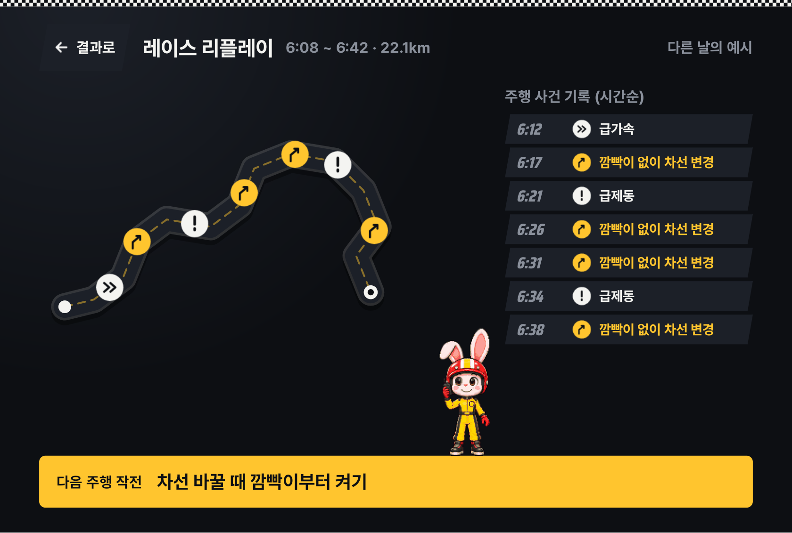</td>
<td>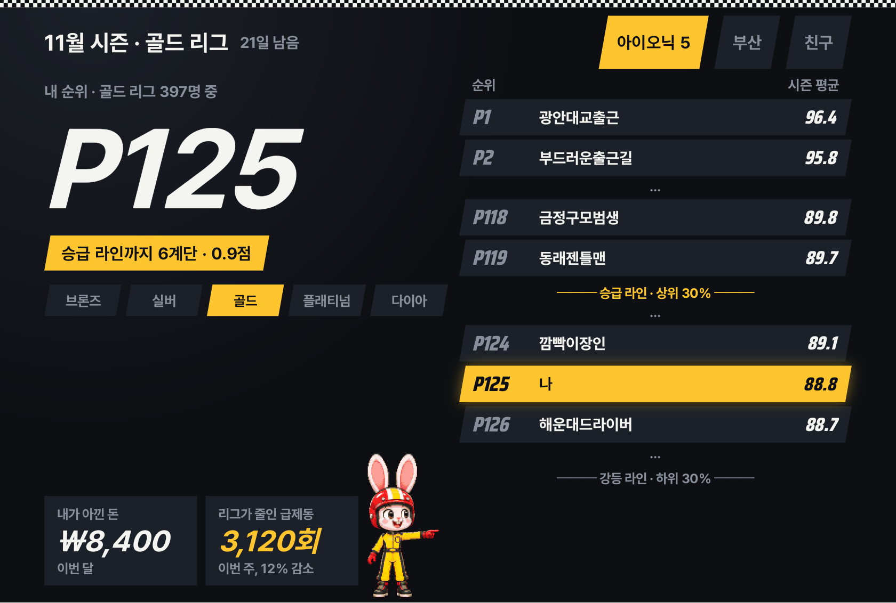</td>
</tr>
<tr>
<td><b>레이스 리플레이</b><br><sub>오늘 경로를 서킷처럼 그리고 급제동·급가속·깜빡이 누락 지점을 표시합니다. 경로는 내 화면에만 보입니다.</sub></td>
<td><b>리그 순위</b><br><sub>같은 티어 안 순위와 승급·강등 라인을 타이밍 타워처럼 보여 줍니다.</sub></td>
</tr>
<tr>
<td>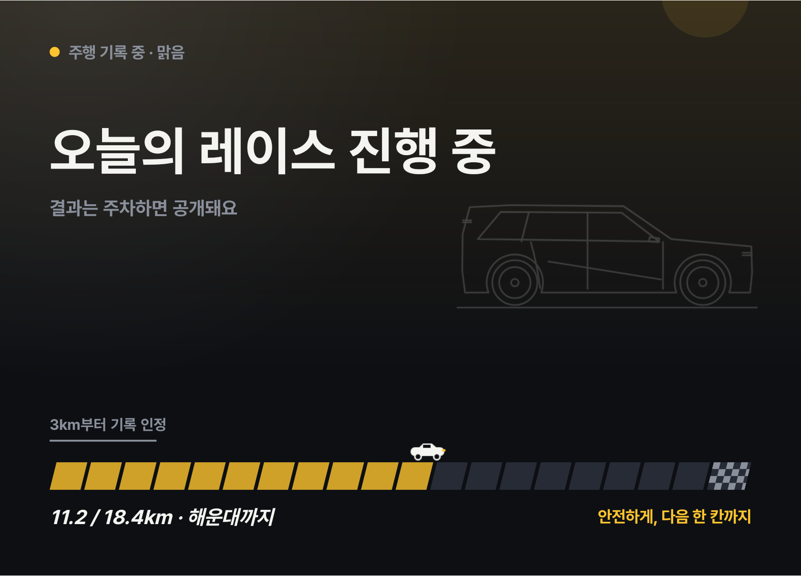</td>
<td>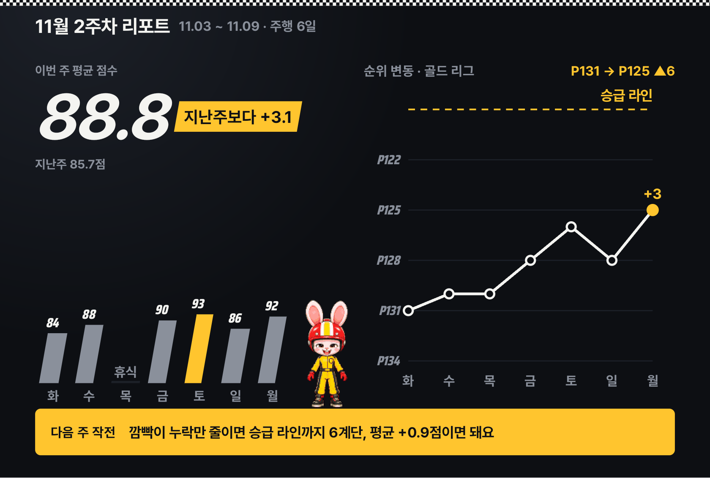</td>
</tr>
<tr>
<td><b>주행 중</b><br><sub>점수·순위·캐릭터 없이, 차량 신호로 판정한 날씨 그림만 정지 화면으로 둡니다.</sub></td>
<td><b>주간 리포트</b><br><sub>요일별 순위 변화를 포지션 차트로, 항목별 점수 변화를 함께 보여 줍니다.</sub></td>
</tr>
<tr>
<td>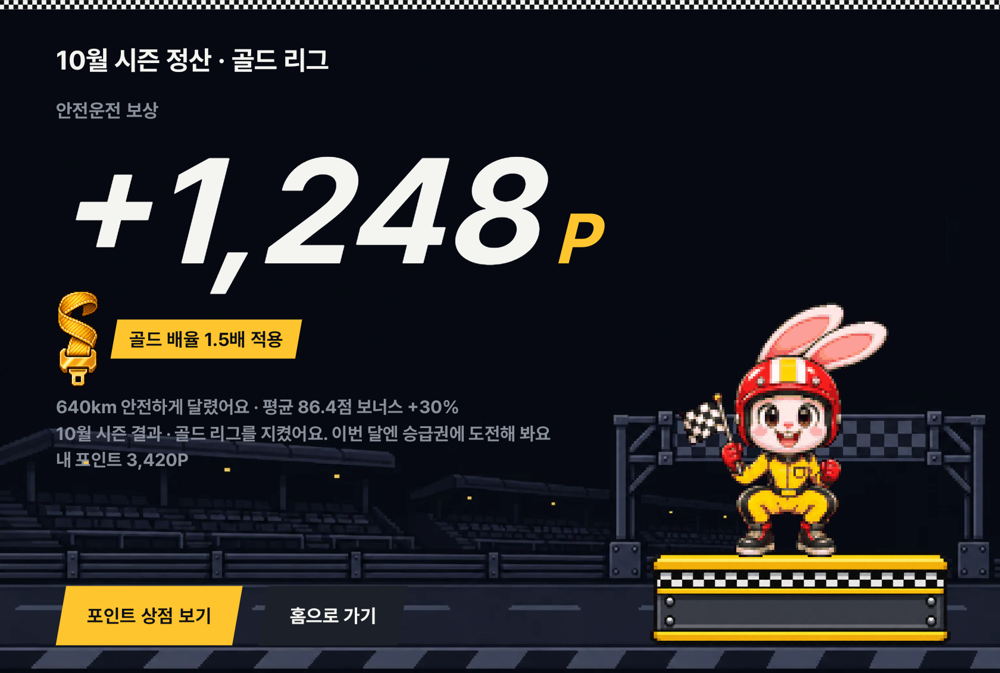</td>
<td>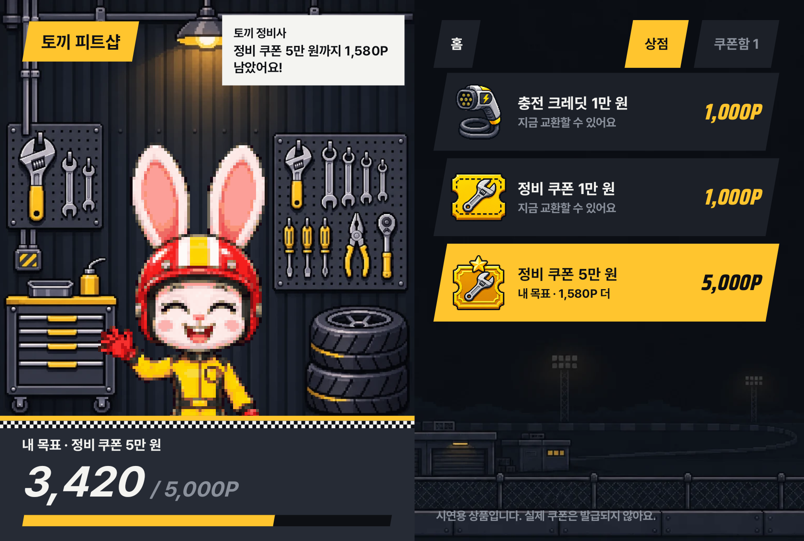</td>
</tr>
<tr>
<td><b>시즌 정산</b><br><sub>달린 거리, 평균 점수, 티어로 포인트를 정산해 시상대에 올립니다.</sub></td>
<td><b>토끼 피트샵</b><br><sub>목표 쿠폰을 정하면 게이지가 차고, 포인트로 충전·정비 쿠폰을 교환합니다.</sub></td>
</tr>
<tr>
<td>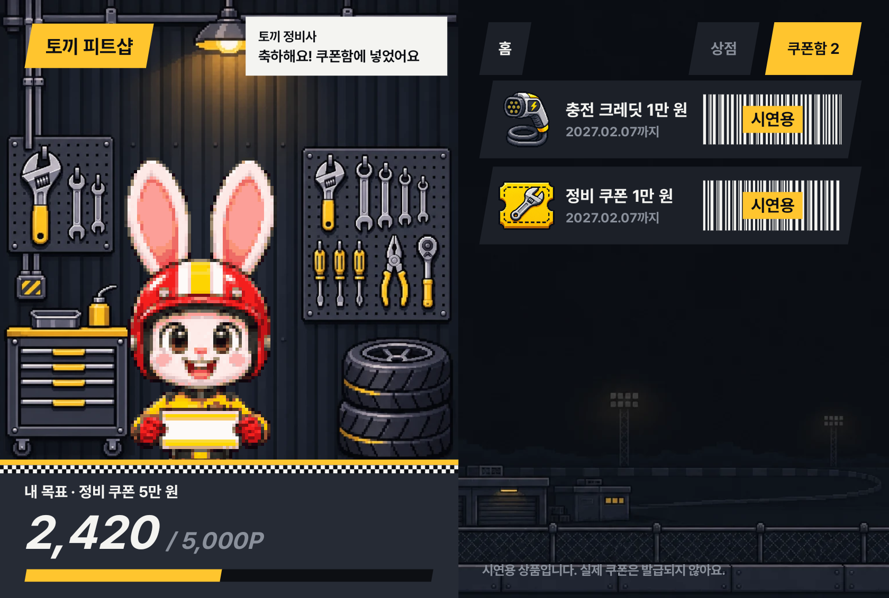</td>
<td>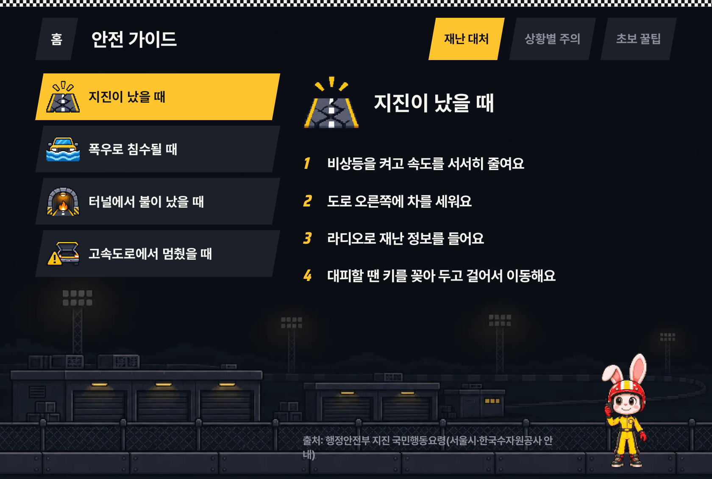</td>
</tr>
<tr>
<td><b>쿠폰함</b><br><sub>교환한 쿠폰의 유효기간과 바코드를 보여 줍니다.</sub></td>
<td><b>안전 가이드</b><br><sub>재난 대처, 상황별 주의, 초보 꿀팁. 법령과 공공기관 자료를 출처와 함께 표시합니다.</sub></td>
</tr>
</table>

<br>

## 점수 산식

트립 하나당 100점. 모든 계산은 [`core/calculator/`](app/src/main/java/io/github/ddayoung03/safetyleague/core/calculator/)의 순수 함수이고 단위 테스트로 검증합니다.

| 항목 | 배점 | 기준 | 차량 신호 |
|---|--:|---|---|
| 부드러움 | **30** | 10km당 급가속·급감속 횟수 | 차량 속도, 브레이크 |
| 매너 | **25** | 깜빡이 없이 차선을 바꾼 것으로 추정되는 비율 | 조향각, 방향지시등, 속도 |
| 에코 | **20** | 같은 차종 평균 대비 전비·연비 | EV 배터리 / 연료 |
| 안전 기본기 | **15** | 출발 전 전 좌석 벨트, 경고 해결까지 걸린 시간 | 좌석 탑승, 안전벨트, 도어, 경고등 |
| 꾸준함 | **10** | 연속 안전 주행일(70점 이상), 주행거리 | 오도미터 |

**공정성 장치**

- 모든 점수를 **10km당**으로 환산해 많이 달린 사람이 유리하지 않게 합니다.
- **3km 미만** 트립은 집계에서 뺍니다.
- 전기차와 내연기관차는 **리그를 분리**합니다.
- 포인트 인정 거리는 **월 1,000km**까지입니다.

<details>
<summary><b>시즌 포인트 정산식</b></summary>

<br>

```
포인트 = 인정 거리(km) × 1P × (1 + 평균 점수 가산) × 티어 배율

인정 거리      월 1,000km까지 (10km당 10P)
평균 점수 가산  70점 이상 +10% · 80점 이상 +30% · 90점 이상 +50%
티어 배율      브론즈 1.0 · 실버 1.2 · 골드 1.5 · 플래티넘 2.0 · 다이아 2.5
```

구현: [`PointCalculator.kt`](app/src/main/java/io/github/ddayoung03/safetyleague/core/calculator/PointCalculator.kt)

</details>

<br>

## 차량 신호

점수 다섯 항목 중 네 개가 **스마트폰으로는 읽을 수 없는 차량 전용 신호**에 의존합니다.

| 용도 | API |
|---|---|
| 속도, 기어(P 전환 시 결과 카드) | AAOS `CarPropertyManager`: `PERF_VEHICLE_SPEED`, `GEAR_SELECTION` |
| 브레이크, 조향각, 방향지시등 | Pleos Vehicle SDK: `Brake`, `SteeringWheel`, `TurnSignal` |
| 좌석 탑승, 안전벨트, 도어, 경고등 | Pleos Vehicle SDK: `Seat`, `Safety`, `Door` |
| 전비·연비, 주행거리 | Pleos Vehicle SDK: `EvBattery` / `Fuel`, `Odometer` |
| 주행 중 날씨 배경 | Pleos Vehicle SDK `Wiper`, AAOS `ENV_OUTSIDE_TEMPERATURE`, `HEADLIGHTS_STATE` |
| 지역 리그, 리플레이 경로 | `FusedLocation` → `NaviHelper` → `LocationManager` 순으로 대체 |
| 주행 중 화면 제한 | AAOS `CarUxRestrictionsManager` |

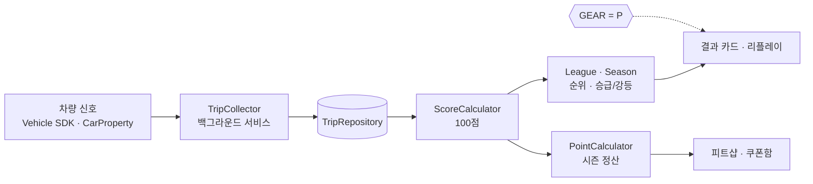

<br>

## 시작하기

**바로 설치 (release APK):** [`apk/SafetyLeague_release.apk`](apk/SafetyLeague_release.apk) 또는 [GitHub Release v1.0](https://github.com/ddayoung03/safety-league/releases/tag/v1.0)에서 받아 Pleos Connect 에뮬레이터에 설치합니다.

```bash
adb install -r apk/SafetyLeague_release.apk
```

**직접 빌드할 때 필요한 것:** JDK 17, Android SDK 34, [Pleos Connect 에뮬레이터](https://document.pleos.ai/docs/connect/guide/getting-started/application-development/setup-connect-sdk-emulator)

```bash
git clone https://github.com/ddayoung03/safety-league.git
cd safety-league

./gradlew assembleDebug           # 빌드
./gradlew testDebugUnitTest       # 단위 테스트
adb install -r app/build/outputs/apk/debug/app-debug.apk
```

**Virtual Console로 주행해 보기**

```bash
adb forward tcp:8088 tcp:8088     # http://127.0.0.1:8088/
```

1. 앱을 켜고 차종을 고른 뒤 위치 기록 동의 여부를 정합니다.
2. Virtual Console에서 안전벨트를 매고 기어를 **D**로 바꾼 뒤 ACCEL로 3km 이상 달립니다.
3. 급제동이나 깜빡이 없는 조향을 섞어 봅니다.
4. 기어를 **P**로 바꾸면 결과 카드가 뜹니다. "리플레이 보기"에서 방금 사건을 확인합니다.

> [!TIP]
> 앱 왼쪽 위 모서리를 길게 누르면 **시연 모드**가 열립니다. 결과 카드, 정산, 피트샵 같은 화면을 바로 띄울 수 있습니다.

> [!IMPORTANT]
> 에뮬레이터는 전비 신호를 지원하지 않고 오도미터가 움직이지 않습니다. 이때 거리는 차량 속도를 시간으로 적분해 계산하고, 에코 점수는 같은 차종 평균으로 둡니다.

<br>

## 프로젝트 구조

```
app/src/main/java/io/github/ddayoung03/safetyleague/
├── core/
│   ├── calculator/    점수 · 리그 · 승급/강등 · 포인트 · 주간 리포트 (순수 함수)
│   ├── collector/     차량 신호 수집, Pleos/모의 데이터 소스, 위치 대체
│   ├── data/          시연 데이터, 안전 가이드 콘텐츠
│   ├── model/         트립 · 차종 모델
│   └── repository/    트립 · 지갑 · 정산 저장소
├── service/           TripTrackingService (주행 백그라운드 수집)
├── weather/           차량 신호로 날씨 판정
└── ui/                화면별 파일 (Home, League, Result, Replay, Report, Shop, Guide …)
    ├── motion/        화면 전환 · 결과 연출 · 효과음
    └── view/          직접 그린 View (토끼 스프라이트, 서킷 경로, 포지션 차트, 신호등)
```

| 폴더 | 내용 |
|---|---|
| [`design/`](design/) | 아이콘, 토끼 스프라이트 원본, 배경, 티어 벨트, 제출 시안 |
| [`mockups/`](mockups/) | 초기 HTML 화면 시안과 테스트 |
| [`docs/`](docs/) | [코드 지도](docs/CODEMAP.md), [개발 기록](docs/app-dev-log.md), [안전 가이드 출처](docs/safety-guide-sources.md), 설계 문서 |

<br>

## 설계 원칙

- **주행 중에는 아무것도 요구하지 않습니다.** 점수·순위·캐릭터는 주차 중에만 나옵니다.
- **아쉬운 날에도 혼내지 않습니다.** 빨강은 출발 신호등에만 쓰고, 감점 숫자를 나열하지 않습니다.
- **경로는 내 것입니다.** 리플레이 경로는 기기 안에만 두고 리그에 공유하지 않습니다.
- **숫자는 테스트로 지킵니다.** 점수, 순위, 포인트 계산은 UI와 분리된 순수 함수입니다.

<br>

## 로드맵

- [ ] 순위 서버 연동으로 차종·지역 리그 실시간 집계
- [ ] 블루멤버스 포인트, 실제 충전·정비 쿠폰 연계
- [ ] 점수 기반 운전자보험 할인(UBI)
- [ ] 법인 차량용 사내 안전 리그(Fleet API)
- [ ] Gleo AI 음성 조회: "이번 주 내 점수 알려줘"

<br>

## 크레딧

- 한글 글꼴 **SL Sans**: [Pretendard](https://github.com/orioncactus/pretendard)를 서브셋하고 이름을 바꾼 글꼴입니다 ([SIL OFL 1.1](app/src/main/assets/licenses/Pretendard-OFL.txt)).
- 숫자 글꼴 [Saira Condensed](https://fonts.google.com/specimen/Saira+Condensed) (SIL OFL 1.1).
- 차량 데이터: [Pleos Connect SDK](https://document.pleos.ai/).

<br>

## 개발 도구와 AI 활용

- 점수 규칙, 화면 방향, 기능 범위 같은 주요 결정은 개발자가 내리고, 아이디어 정리와 구현은 AI 코딩 도구(Claude Code, Codex)와 함께 했습니다. 커밋의 `Co-Authored-By` 표시는 AI가 함께 작성한 부분입니다.
- 모든 변경은 단위 테스트와 Pleos Connect 에뮬레이터 실행으로 검증했습니다.
- 토끼 캐릭터, 배경 등 일부 그림은 AI 이미지 생성 도구로 만든 뒤 다듬었습니다.

<div align="center">
<br>
<sub>현대자동차그룹 차량용 앱 개발 공모전 출품작</sub>
</div>
